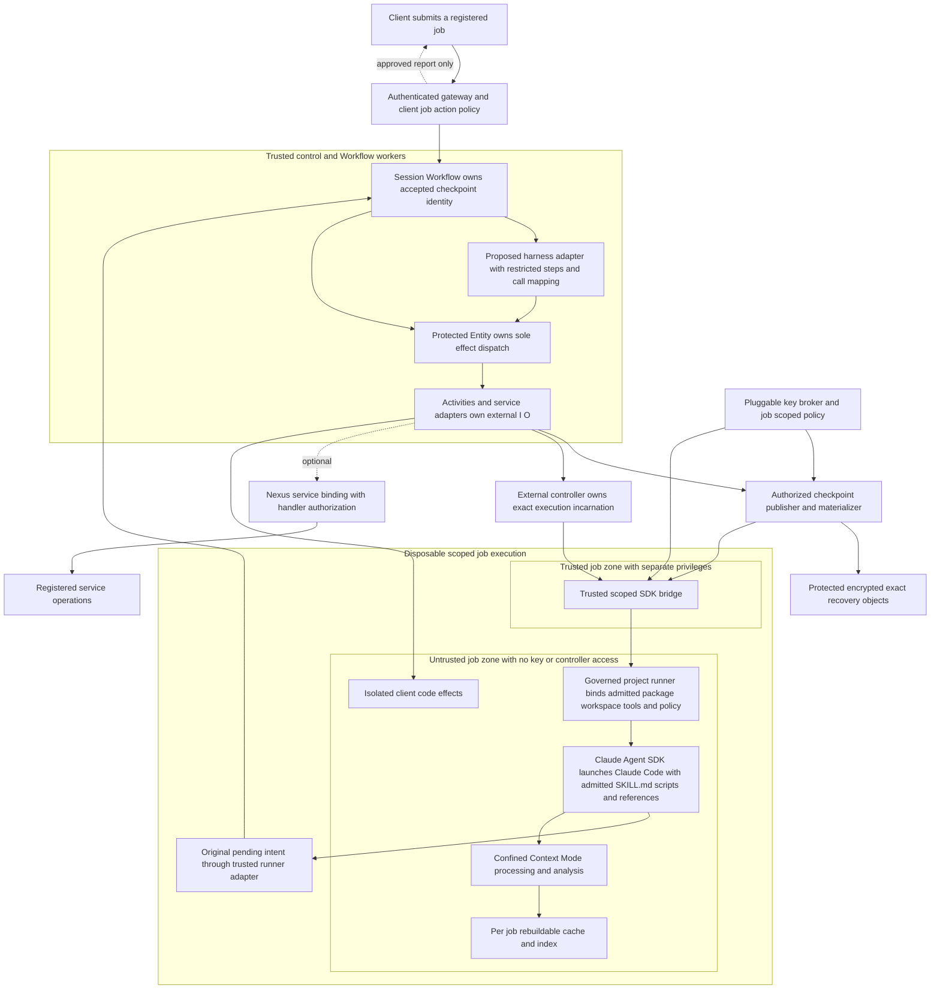
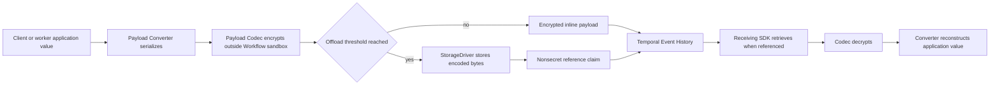
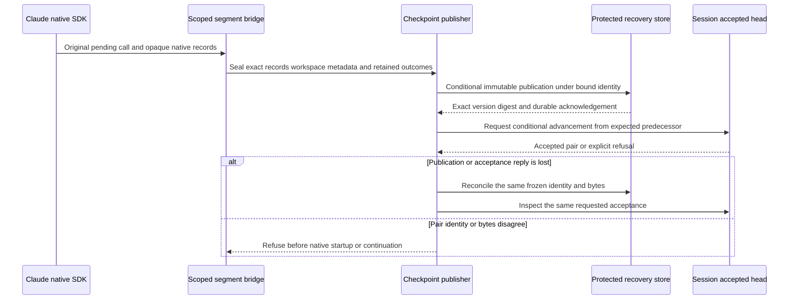
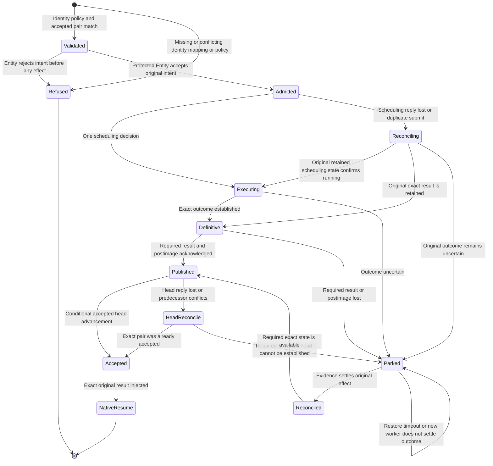
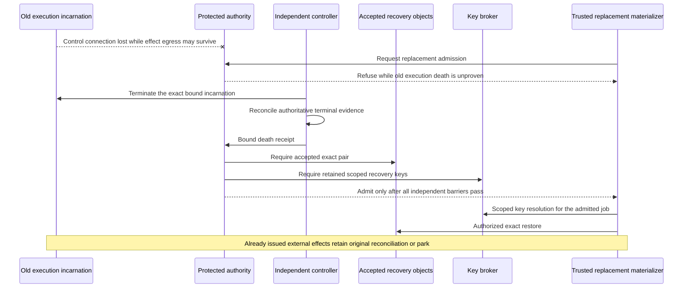
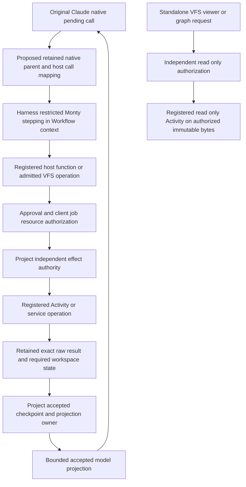
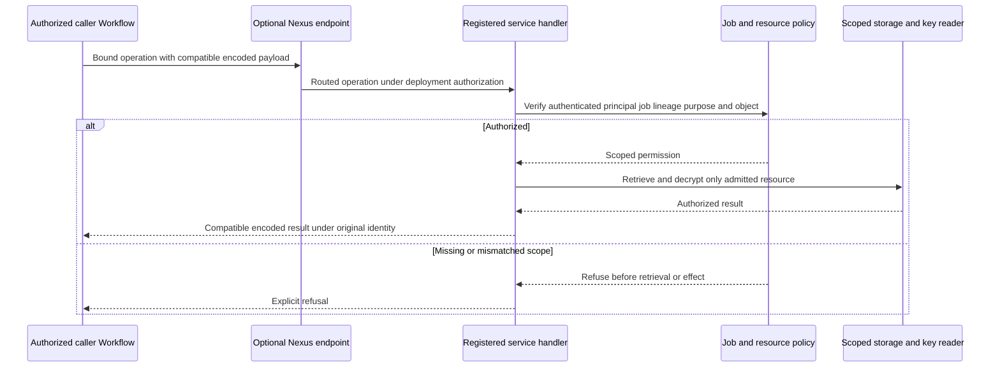
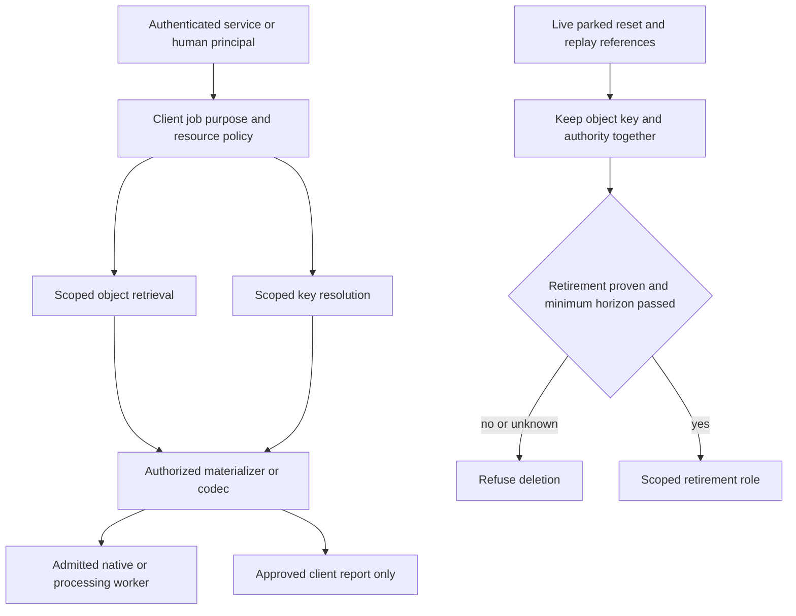
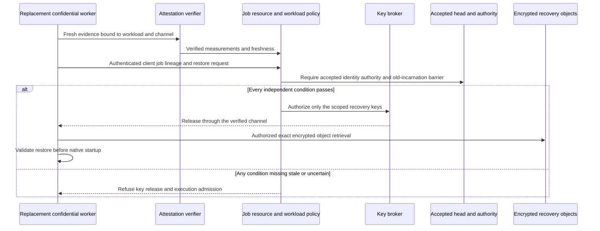
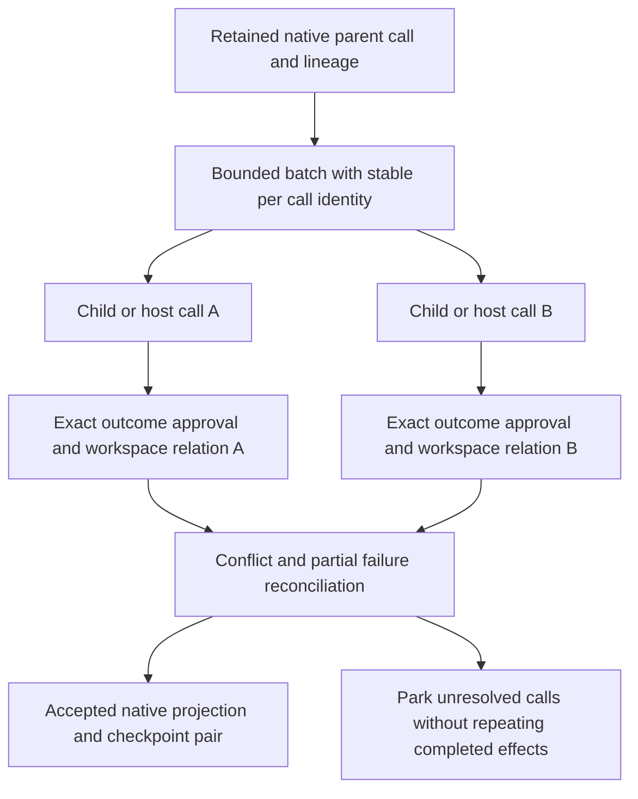

# Durable skill architecture review pack

Status: Architecture evaluation input. The owning tickets determine admission and qualification status.

## Purpose and intended product

Build a self hosted service that accepts registered skill jobs against authorized client code and returns reports. Claude Agent SDK remains the agent loop. Temporal coordinates job state, approvals, original call outcomes and recovery. Context Mode supplies selected context reduction, file/output processing, search and governed code analysis. A project owned adapter can reuse the Temporal agent harness's restricted Code Mode patterns without replacing the native Claude loop.

The system must resume the original pending native call with its exact accepted result and corresponding workspace. A cache, a VM snapshot or a successful upload alone does not establish that recovery point. An effect with an uncertain outcome must reconcile or remain parked. Restoring files does not create permission to execute an old effect again.

The approved first profile is self hosted: separate trusted checkpoint/key/controller service containers and a disposable Linux execution container. [The current configuration owner](dsr-0.6-configuration.md#approved-local-configuration-2026-10-14) records the selections under [DSR-0.6](../../../tickets/phase-0.md#dsr-06-decide-the-workspace-volume-class-and-the-effect-isolation-level). Initial local container proof comes first; DSR-4.3 retains later host/disk-loss and live-partition qualification before portable admission. Earlier S3/Entity/EC2 selections remain a later provider reference. No cloud spending or provisioning is required now.

## Decision and evidence legend

| Label | Meaning in this pack |
|---|---|
| Approved direction | Provider independent interfaces, self hosted priority, registered hosted skill jobs, sensitive data separation and the synthetic bounds below. This does not approve every concrete runtime/key/provider setting. |
| Current source seam | A capability inspected in pinned source. It is not a passed integration test or deployment qualification. |
| Proposed adapter | Required project integration still needing exact mapping, admitted dependencies and meaningful positive/refusal proof. |
| Future profile | An optional capability, such as Nexus transport or confidential execution, with separate activation gates. |
| Open binding | A runtime, identity, key, reader, storage, termination or license choice not settled by the discussion. |

A session boundary design review reported CONDITIONAL: codec/storage/Nexus/attestation boundaries are viable, subject to explicit native/harness correlation, job reader checks, plaintext placement and physical recovery proof. That review has no committed record. Treat its verdict as unrecorded input, not evidence, until a report is committed and linked here. No native integration, infrastructure, paid model, image or security qualification ran. The existing transcript checker could not prove Codex skill loads or role call counts; this pack does not convert declarations into machine proof. The owning ticket records the current DSR-0.6 decision disposition. DSR-2.1 remains blocked while other prerequisites are incomplete.

## Component and trust boundaries

The restore/key arrows end in the trusted job zone. They represent authorized trusted processing, not keys exposed to arbitrary client code. Application execution follows the governed project runner, Claude Agent SDK and Claude Code. The runner binds admitted package metadata, dependencies, tools, permissions and workspace before native skill loading. Mods are not required for native loading and remain a separately qualified inner hook candidate. The pending intent returns through the trusted adapter to accepted Session state and Entity scheduling; no direct SDK-to-effect dispatch is admitted. The harness adapter dispatches effects only through the protected Entity, as in the harness view below. Separate privileges, process/container placement and scoped credentials must enforce this. Effects cannot read controller sockets, host credentials or authority administration keys. The controller and accepted storage remain outside the disposable worker failure domain. Sharing a physical host is allowed in a trusted-host development profile, but that host cannot independently prove its own death.

Workflow logic handles deterministic state and recorded outcomes. Network, filesystem, provider and key operations execute in the appropriate Activity, SDK codec/client or external service/controller boundary. An ordinary local call inside Workflow logic is suitable only for deterministic computation. The Python Workflow sandbox is not the security isolation mechanism for arbitrary client code.

## Temporal payload encryption and external storage

This is a documented Temporal mechanism. The receiving Clients and Workers must have compatible converters, codecs and storage configuration. External Storage is currently Public Preview, and the SDK APIs are marked experimental; pin the actual SDK/API and qualify required routes. Encrypted external bytes still need retention and reader authorization. The reference claim is not automatically protected by the same payload codec. Keep secrets, bearer URLs and sensitive client content out of reference metadata, headers, logs and Search Attributes. Common failure messages/stack traces require the explicit failure conversion policy.

The trusted Workflow worker receives decoded application values. A confidentiality claim must therefore include it in the plaintext trust boundary. A Codec Server or UI/CLI download endpoint is another plaintext recipient, with its own authentication and authorization. Do not grant every Namespace user unrestricted decrypt access to every client job.

Source: [Temporal External Storage](https://docs.temporal.io/external-storage), [Payload Codec](https://docs.temporal.io/payload-codec) and [Codec Server](https://docs.temporal.io/codec-server).

## Native session and workspace checkpoint publication

The Session Workflow owns accepted-head identity. The checkpoint store cannot independently accept a recovery point. There is no claimed atomic transaction across Temporal and the object store. All required objects must be complete and acknowledged before advancement. Publication retry reconciles the original identity; it must not publish new bytes under an old logical operation or select an uploaded latest object.

Retain opaque conversation/pending records, workspace metadata, required preimage/postimage and exact raw outcome/projection references as specified by the canonical contract. Preserve hidden files, deletions, executable bits and admitted links/ownership metadata. Reject traversal, escaping links, unsupported metadata, sockets/devices and credential archives. Reinject separately approved secret references. A payload offload driver or Context Mode SQLite index does not satisfy this publication protocol.

Existing owners: [DSR-0.11 and other Phase 0 decisions](../../../tickets/phase-0.md), [workspace and original-call integration](../../../tickets/phase-2.md), [retention and recovery qualifications](../../../tickets/phase-4.md).

## Effect execution, publication gaps and replacement

The Refused effect-admission outcome applies before scheduling. After admission, duplicate submits and lost replies reconcile the original retained status or result without another dispatch. Park only when the original outcome or required accepted state cannot be established. An individual storage, authorization or head request may refuse after an earlier effect; that refusal never proves the earlier effect did not run. An effect may succeed before publication fails. Recovering output by rerunning that effect is forbidden. An accepted checkpoint whose required bytes are lost is a durability failure, even if refusal preserves execution safety. Routine destructive cleanup must not remove sole-readable required bytes while sealing/publication remains unresolved. Urgent containment or actual host loss can destroy those bytes; retain park/data-loss classification instead of inventing success.

Do not equate Activity cancellation, timeout, lease expiry, container deletion acknowledgement, API disappearance or replacement attestation with old execution death. The required qualification cases remain distinct: surviving-host recovery, original disk unavailable with replacement on another host, and a partitioned old execution that retains effect egress until independently confirmed termination. A single host local fixture cannot prove all three. Initial local qualification uses separate service and execution containers on the trusted development host. Host/disk-loss and live-partition proofs follow initial execution and remain mandatory before portable admission. The [approved configuration owner](dsr-0.6-configuration.md#local-profile-and-later-portable-proof) records this sequence and the existing provider reference; no cloud spending is required now.

## Temporal agent harness integration

The harness source pin is [30b0c7f0affb0629cac4c846d0cb88589571e484](https://github.com/temporal-community/temporal-agent-harness/tree/30b0c7f0affb0629cac4c846d0cb88589571e484), experimental, five commits after the [0.6.0 release tag](https://github.com/temporal-community/temporal-agent-harness/tree/04a49d1b037de46da2cba31676d2aa2f4c59118f). Its pyproject still reports 0.6.0. The inspected pin contains activity_fs.py, VFS and FileIndex; the release tag does not. PR 19 merged earlier and is restricted Code Mode precedent. Source identity and future adapter admission are owned by [the configuration record](dsr-0.6-configuration.md#component-admission-and-finite-qualification). Do not attribute later source seams to the released package.

This is a proposed adapter, not current native compatibility. The harness driver generates its own deterministic host-call UUIDs. They do not automatically equal the Claude native tool-use ID or project authority key. Retain an explicit mapping for parent/script/host calls, ordinal and lineage. Missing or conflicting mappings refuse before effects. Preserve approvals, exact raw results and the accepted projection; JSON rendering alone is not exact native output preservation.

Monty runs restricted computation with pooled processes from Workflow stepping. Its suspension dump is transient Workflow memory; replay regenerates it from recorded host outcomes. It is not a durable native checkpoint. Preserve the pinned replay/timeout semantics when adapting it. Context Mode's subprocess analysis is a different mechanism and must be separately confined.

Harness FileIndex reads current backing-store contents, not a historical accepted snapshot. VFS view/graph Activities can be called independently of the model tool path. The viewer route above is read only and cannot reach the mixed effect operation or bypass Entity scheduling. Enforce job authorization there, not only at `run_code` or model approval. Caller supplied filesystem configuration is not entitlement. The package's default local payload directory is a development facility; it does not qualify cross-host recovery, per-job isolation or retained-reference deletion safety.

Current Claude source requires original-session/first-attempt native pending recovery in the inspected lane. The adapter must preserve required refusals rather than loosening them to make reuse work. Keep the qualified native proof lane distinct from the current integration lock. No new runtime, optional interpreter or fork dependency is admitted by this pack. [Context/harness source research](context-execution-research.md) owns the fuller comparison and dependency evidence; [DSR-7.2/7.3](../../../tickets/phase-7.md) own the restricted runner and identity integration gates.

## Context Mode and client data placement

Context Mode remains selected for processing, context reduction, indexing/search and governed code analysis. Use authorized immutable inputs and explicit per-job cache/index paths. Preserve original retained output separately from bounded model excerpts. An index can be rebuilt; native accepted state cannot be replaced by a fresh search result. No global shared host cache is admitted.

Client code access does not require the skill and repository to share one container. Co-location is allowed if the boundary remains enforced. Commands that execute client code stay inside the admitted execution environment. A trusted reader may supply registered immutable bytes to a confined processor. Controller, authority and key administration privileges remain outside untrusted code execution.

The pinned upstream Context Mode executor can inherit process environment and discover runtimes. Its defaults are not a security sandbox. Governed analysis needs explicit runtime mapping, limits, immutable input, scoped scratch and denied administrative/network capabilities. The source/API selection and hosted Elastic-2.0 intended-use assessment are approved at the configuration owner. Reproducible build, platform/dependency inventory and enforcement remain qualification gates. Registered skill jobs preserve the processing/search/analysis benefits; clients cannot directly invoke Context Mode tools or arbitrary analysis code. Smaller file count, extraction or hidden endpoints do not remove license obligations. [Current configuration decisions](dsr-0.6-configuration.md) and [source research](context-execution-research.md) remain the owners.

## Nexus service operations and authorization

Nexus is an optional service transport. Local services/Activities can satisfy the first self hosted profile. Caller and handler Data Converters must be compatible; encryption/key access applies to both input and result paths. A secured self hosted cluster needs actual authorization configuration. Temporal Cloud endpoint Namespace allowlists must not be assumed in self hosted deployment.

The pinned harness Nexus handler constructs Workflow IDs from supplied session IDs and uses request IDs for Update deduplication. That is routing/deduplication evidence, not client/job authorization. Do not expose its full agent/approval/callback service as the registered hosted API without policy enforcement. Request deduplication is not lifetime authority or permission to rerun an uncertain effect.

External retrieval happens before codec decode. Therefore authorization only inside decryption is too late for the required before-retrieval policy. The inspected Python SDK `StorageDriverRetrieveContext` carries no fields, so it supplies no authenticated reader identity. `StorageDriverStoreContext` does carry a Workflow or Activity target, so job scope is available when objects are written but not when they are read. The [approved configuration](dsr-0.6-configuration.md#certificates-encryption-keys-and-readers) selects the scoped reader broker. Trusted SDK-to-broker scope propagation, enforcement on every direct VFS/UI/CLI entrance and runtime qualification remain unimplemented. Broker selection does not prove that an offload reference carries reader identity. Source: [Nexus security](https://docs.temporal.io/nexus/security).

## Key services, readers and retention

Recommended readers: clients access only their own approved jobs/reports; the materializer/native engine reads the accepted pair for its admitted job; artifact processors read registered inputs; publishers seal objects; controllers read admission and termination descriptors without general plaintext access; key services authorize envelope operations; janitors delete only after reference retirement. [The approved configuration](dsr-0.6-configuration.md#certificates-encryption-keys-and-readers) records the role holders, certificate authentication, separate action authorization, cryptographic choices, key broker and scoped reader policy. DSR-0.7/0.11 retain actual gateway/store/key enforcement and real client retention prerequisites; documentation selection does not qualify those implementations.

Use pluggable self hosted key services. AWS KMS can be another backend, not a primary requirement. Keep transport TLS, payload encryption, checkpoint encryption and storage-at-rest protection distinct. Key IDs are not reader permission. Data encryption does not establish current-head freshness. Signed human decisions bind the existing workflow/lineage, subject, purpose, payload digest, expiry, nonce, key ID and token-version contract; preserve reset/replay checks. Signing-key revocation and recovery decryption-key retention have different lifecycles.

Approved synthetic limits: one session, one pending call, one harmless effect, 3,000,000 workspace bytes, 65,536 model-visible output bytes, a 600 second deadline, an 86,400 second recovery/reset window, and at least 604,800 seconds of object/key/authority retention, extended while any live, parked, reset or replay reference needs them. Unknown retention refuses deletion. These are future test configuration approvals, not test results. Real client data requires the client's approved retention policy. Erase-every-copy-at-worker-death cannot coexist with retained-copy recovery unless the client approves that recovery limitation or retained data.

## Future confidential container profile

Confidential Containers Trustee supplies prior art for attestation verification and conditional secret release. It is not selected or installed here. A future profile must specify the threat model, approved workload/configuration measurements, freshness, key release/revocation, encrypted restore, rollback resistance and controlled egress. The current profile trusts the host/provider. A microVM alone does not prove protection from a malicious host.

Every process receiving sensitive plaintext must be inside the qualified confidential boundary or explicitly trusted under the declared threat model. This includes Workflow Workers, codec readers, native engine, analysis processors and optional viewers. Attesting only the disposable execution container is insufficient for a claim that an adversarial host cannot observe all client data. Approved-image attestation also does not make arbitrary client code safe.

Attestation is an additional key-release condition. It does not replace accepted-head identity, effect authority, old-incarnation death or original outcome reconciliation. Released keys may remain with an old live execution. Data sent to an external model remains subject to the client/model disclosure policy. Source: [Trustee architecture](https://confidentialcontainers.org/docs/attestation/architecture/).

## Positive child and parallel recovery requirements

Positive native child and parallel support remains selected at [DSR-7.4](../../../tickets/phase-7.md). Require bounded count/depth/identities, conflict handling, partial failure, approvals, descendant containment, reset/Continue-As-New and exact native results. The current engine's main-agent-only gap is explicit. Harness concurrency is partial precedent, not native compatibility proof. A serial deny/control case must remain, but cannot substitute for positive tests. This review pack does not remove or defer the selected requirement.

## Required integration and qualification evidence

| Boundary | Evidence needed before admission | Failure or refusal to test |
|---|---|---|
| Native engine and harness adapter | Exact original pending call, retained host-call mapping, native result and projection compatibility | Missing/conflicting IDs, unsupported engine mode, lost callback, retry/fork mismatch |
| Checkpoint store | Complete acknowledged exact pair, conditional publication/head advancement and metadata conformance | Changed bytes, lost ACK, stale head, missing accepted object, traversal and escaping links |
| Dispatch authority | One scheduling decision, retained logical dedup/pending state, protected lifecycle and handover | Duplicate submit, lost reply, reset/delete/recreation/rollback, expired authority |
| Execution/controller | Bound create identity and independent terminal receipt; three distinct recovery cases | Partitioned live execution, ambiguous create/kill reply, stale incarnation and descendant escape |
| Reader/key services | Authenticated scope before retrieval/decryption on all entrances, retained old keys | Cross-client claims/key IDs/VFS configs, direct viewer calls, missing/revoked key and unknown retirement |
| Temporal payload path | Exact compatible converter/codec/storage versions on every producer and consumer | Inline/offloaded paths, failure encoding, reference metadata, replay/reset and converter skew |
| Context Mode | Exact admitted source/API/dependencies, confined analysis, notices and hosted intended-use assessment | Shared cache, environment/credential leakage, live-workspace substitution, unrestricted tool access |
| Child/parallel | Positive bounded native calls plus serial control, conflicts and partial failure | Duplicate effects, lost child outcome, authority/correlation mismatch and escaped descendants |
| Confidential profile | Attestation/channel/workload/job policy and full plaintext placement proof | Stale evidence, unapproved measurement, wrong job, rollback and old live worker |

Source-only inspection supplies no physical/provider guarantee. Development fixtures do not qualify production durability or authentication. Runtime/image/kernel/dependency digests, storage/key policies, authenticated reader propagation, terminal-incarnation witness and complete component/license admission remain required bindings. Actual account/resource IDs must be sealed before execution; this documentation task does not create them.

## Instructions for an independent evaluation session

Read this pack, the canonical spec/plan/work-items, all maintained tickets, the candidate spec/plan and evidence, current configuration decisions, source research and the entire handoff. Inspect Git status and preserve the dirty checkout. Treat later operator self hosted direction and earlier AWS target wording as an explicit reconciliation item, not permission to change contracts silently.

Verify against pinned source rather than this narrative alone. Check the harness runner/driver/VFS, standalone viewers, converter plugin, large payload driver and Nexus handlers. Inspect the actual Claude segment, native SessionStore and Workflow dispatch guards. Verify Temporal mechanisms with current official Docs and Atlas through permitted wrappers. Distinguish current behavior, approved direction, proposed adapter, future profile and unanswered binding for every finding.

Evaluate these questions: Is every state/permission owned once? Can an untrusted input choose another client's object/key/endpoint? Does any reader bypass policy? Do codecs/offload cover every admitted route without hiding references or metadata? Does the adapter preserve native IDs/results rather than creating another loop? Are workspace/native pairing and publication gaps safe? Can a partitioned old worker still act? Does deletion preserve every live/reset/replay reference? Does confidential placement include every plaintext recipient? Are selected Context Mode, native projection, restricted Code Mode and positive child/parallel requirements all retained?

Return a boundary-specific verdict and a separate whole-ticket verdict. Name precise sources, counterexamples, owner decisions and acceptance evidence. Do not close DSR-0.6 from this pack or from a passing diagram parser. Recommend corrections without treating a recommendation as an operator approval. No implementation, dependency installation, experiments, credentials, infrastructure, external contact, commits or pushes are authorized by this pack.
